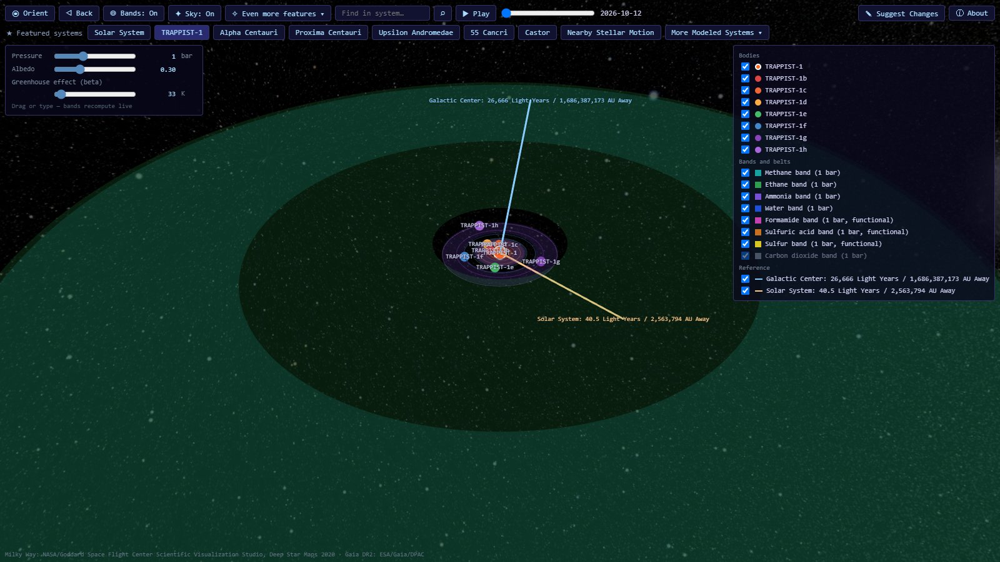

# Hybrasil Star and Exoplanet Map

[](LICENSE)
[](LICENSE-DATA)
<!-- DOI badges for the software and the dataset go here once Zenodo has minted them. -->

**[Open the map at hybrasil.app](https://hybrasil.app)**



An interactive 3D map of nearby star systems. Every star, planet and moon is
drawn on its published orbit and animated in the browser with three.js. Each
star also gets a set of **solvent bands**, the ranges of orbital distance
where water, ammonia, methane and five other candidate solvents could stay
liquid.

- **Seven featured systems**, built from the literature: the Solar System,
  TRAPPIST-1, Alpha Centauri, Proxima Centauri, Upsilon Andromedae, 55 Cancri
  and Castor.
- **About 420 planetary systems** within 100 light years, and **68 systems of
  four or more stars** with no known planet, from the Hybrasil Star and
  Exoplanet Dataset.
- **Two views of stellar motion:** every nearby star with its velocity, and
  the S-stars on their orbits round Sgr A*, the black hole at the centre of
  the Milky Way.

This repository, <https://github.com/CadeSummers/hybrasil>, is the official
upstream, and <https://hybrasil.app> is the official site. Forks are welcome
under the licences below; please do not present one as the original.

## Goals

1. **From raw data to simulation.** Take the raw material astronomers publish,
   such as orbital solutions and parameter tables from papers, and telescope
   data like radial velocities, transit timings, astrometry and survey catalogs.
   Build each simulation directly from that data, with every value traceable to
   the publication or observation it came from.
2. **A public resource for nearby stars.** Publish the simulations as a
   website: an open, browsable collection of models for the star systems around
   us, for anyone who wants an astronomical model of a nearby star or a single
   place where the simulations are gathered.

## Running it

The site needs nothing installed. To run it yourself, from a clone of this
repository (Python 3.10 or later):

```bash
pip install -e .                    # or: pip install -r requirements.txt

python -m hybrasil.cli --serve      # the whole app, at http://127.0.0.1:8765/
python -m hybrasil.cli --system solar          # one system, opens in the browser
python -m hybrasil.cli --system trappist-1
python -m hybrasil.cli --source catalog --system "HD 18143"
python -m hybrasil.cli --list-solvents
python -m hybrasil.cli --system solar --renderer plotly  # the original Plotly viewer
python -m hybrasil.cli --help                  # every option
```

Optional extras: `pip install -e ".[horizons]"` for live elements from NASA
JPL Horizons (`--source horizons`), `".[png]"` for PNG export, and `".[dev]"`
for the test suite. Install from a clone rather than from a wheel: the catalog
systems are read from the dataset snapshot in `data/`, which is not packaged.

### What opening the simulation gives you

These are the baseline. Tests pin both of them (`tests/test_featured_baseline.py`,
`tests/test_catalog_loader.py::TestWholeSystems`).

- **Every featured system is always there.** Opening the viewer in any way
  puts all seven built-in systems in the switcher along the top. `--system`
  chooses which one opens first. A system from another source (`--source
  catalog`, `--source file`, `--source horizons`) is added after the seven as
  an eighth button, and opens first. A catalog system that a featured system
  already draws opens as the featured one. For example, `--source catalog
  --system "55 Cnc g"` opens the featured 55 Cancri.
- **A multi-star system is drawn whole.** Every star in the system is drawn,
  and each planet orbits its own star. 55 Cancri shows both 55 Cnc A and
  55 Cnc B, with B's two planets circling B. Alpha Centauri shows A, B and
  Proxima.
  - **Built-in systems** place each companion from its published orbit.
  - **Catalog systems** place it from the dataset's Separation columns on
    the multi-stars tab. A solved orbit is drawn as its ellipse. A projected
    separation, a lower bound on the real distance, is drawn as a circle at
    that distance and marked hypothetical. Every companion in the dataset
    has a sourced separation (23 September 2026 entry on Sources &
    Provenance).

### The web app

```bash
python -m hybrasil.cli --serve
```

This opens the three.js viewer from a small local server at
`http://127.0.0.1:8765/`. The bar along the top has two ways in:

- **★ Featured systems:** one button for each built-in system, whose orbits
  come from the literature, and one for the Nearby Stellar Motion view.
- **More Modeled Systems ▾:** a dropdown that opens on a **System Type:**
  row: **Planetary** (the default), **High Star Count (Planetless)** (the
  systems of four or more stars within 100 ly that have no planet; the ones
  with a brown dwarf -- a planet in this model -- and Castor are under
  Planetary) and **Stellar Motion** (Nearby Stellar Motion, and the Sgr A*
  Cluster: the S-stars on their orbits round the Milky Way's supermassive
  black hole). The search box searches the chosen type. Planetary lists every
  planetary system in the dataset, about 420 of them. It lists the systems
  with the most planets first, and nearest first among those with the same
  count. The list is twelve systems tall and scrolls for the rest; click one
  to draw it. Candidate planets count, so the number is how many planets the
  viewer draws.
  The search box at the top of the dropdown finds any system by name, and
  tolerates typos ("trapist" finds TRAPPIST-1). It also matches catalog-style
  names typed the long way ("tau ceti" finds tau Cet) and nicknames
  ("Copernicus"). A planet's or a companion star's name finds the system it
  belongs to.

The hosted site is the same app written out as static files:
`python -m hybrasil.cli --build-site site` pre-builds every system's scene into
`site/` (about two minutes, about 420 MB), and any static host can serve it.

#### What is stored and what is built on lookup

The star and planet *data* is stored. Each system's 3-D *scene* is built the
first time you open it.

- **The data:**
  - The seven featured systems are written into the code
    (`hybrasil/data/builtin_systems.py`), with values taken from
    published papers.
  - Every other system comes from the dataset snapshot committed in `data/`.
    The dataset is maintained in a private spreadsheet, and each new snapshot
    of it is committed here, so every version of the site can be rebuilt from
    this repository alone.
- **The scenes:**
  - When the page loads, the server sends only the list of systems
    (`/api/systems`). Nothing is drawn yet.
  - When you pick a system, the server works out its orbits, animation frames
    and solvent bands, and converts them into a three.js scene. It then sends
    the scene to the page (`/api/systems/<id>`).
  - Each built scene is kept in memory until the server stops. A second visit
    to a system is instant; the first visit to a large one takes a moment.
- **On disk:** nothing is written, apart from any Suggest Changes
  submissions, which `--serve` appends to a local `suggestions.jsonl`.
  `--output html` is the separate way to save a system as a file, and
  `--build-site` the way to save them all.

### The viewers

The default viewer is three.js. Its logarithmic depth buffer lets one camera
cover everything from a moon's orbit to the whole system, so zooming is smooth
at every scale. `--renderer plotly` opens the original Plotly viewer. The two
share their band sliders, search and info panel from one file
(`hybrasil/viz/band_kit.js`), so they can't drift apart. PNG export
(`--output png`) always uses Plotly.

`tests/test_browser.py` drives both viewers in headless Chromium through
Playwright. After `pip install -r requirements-dev.txt`, run
`python -m playwright install chromium` once. The browser tests take about
three minutes; `pytest -m "not browser"` skips them.

In the viewer, the system buttons along the top switch between systems. Behind
every system is the Milky Way, NASA's Deep Star Maps 2020 (from Gaia DR2),
dimmed so the orbits stay readable. It is turned into each system's own frame,
so the galactic-centre arrow points at the galactic centre in the picture. The
**Sky** button turns it off, and the viewer remembers that choice. Only the
three.js viewer draws the sky. The **Bands** button shows the solvent bands, and the panel in the top-left moves
them: pressure, albedo and the greenhouse effect. `python -m hybrasil.cli
--help` lists every option. `CLAUDE.md` has the full command list and the
architecture, and `docs/architecture/` a deep dive on each part.

## How the solvent bands are computed

A band is the range of orbits where a solvent's surface temperature sits
between its melting and boiling points. It is a first-order screen, **not a
habitable zone**. The difference is explained [below](#bands-versus-the-habitable-zone).

### 1. Blackbody temperature

A planet at `d` AU from a star of luminosity `L` (in suns), with Bond albedo
`A`, has an equilibrium temperature of

```
T_eq = 278.33 K · L^¼ · (1 − A)^¼ / √d
```

278.33 K is a perfect absorber at 1 AU from the Sun. Turned around for
distance, each edge of a band is

```
d = 278.33² · √L · √(1 − A) / T²
```

with `T` the boiling point for the inner (hot) edge and the melting point for
the outer (cold) edge.

### 2. Pressure and albedo

Melting and boiling points come from the dataset, transcribed at
seven pressures from 0.1 to 100 bar. Between those columns the boiling point
is interpolated with Clausius–Clapeyron (1/T linear in ln P), and the melting
point linearly in ln P. Outside a solvent's own transcribed range there is no
band at all, because extrapolating a vapour-pressure curve is how you draw a
band where nothing is liquid. Albedo defaults to Earth's 0.3. Both are
sliders.

### 3. Greenhouse effect (beta)

A flat offset `G`, in kelvin, added to the blackbody temperature. The default
of 33 K is Earth's: a 288 K mean surface over a 255 K blackbody. Each edge
becomes

```
d = 278.33² · √L · √(1 − A) / (T − G)²
```

It is marked beta because a real greenhouse depends on the atmosphere and the
flux it traps, not on a constant. Past a solvent's boiling point there is no
band anywhere. Past its melting point the band runs out to where the star's
warmth falls to the 2.725 K cosmic microwave background.

### 4. Star colour

Two stars of equal luminosity do not warm a planet equally. A red dwarf's
light is mostly near-infrared: air scatters less of it and water vapour and
CO₂ absorb more of it, so the planet reflects less and the same flux keeps it
warmer. Each star therefore gets a factor `f` on the flux its planets absorb:

```
f(Teff) = S_eff(5772 K) / S_eff(Teff)
S_eff(Teff) = 1.0512 + 1.3242e-4·t + 1.5418e-8·t² − 7.9895e-12·t³ − 1.8328e-15·t⁴
              t = Teff − 5780 K

d = 278.33² · √L · √(f · (1 − A)) / (T − G)²
```

- **Source:** `S_eff` is the runaway-greenhouse limit from Kopparapu et al. 2013 (ApJ 765, 131, Table 3). It uses a thin, water-vapour-rich atmosphere, the closest of their climate limits to the fixed Earth-like atmosphere the bands assume.
- **The Sun:** the factor is normalised at the Sun's 5772 K, so the Sun's `f` is exactly 1 and the Solar System does not move.
- **Examples:** Proxima Centauri (2980 K) gets 1.215, which moves every band out by 1.10×. Upsilon Andromedae (6212 K) gets 0.946.
- **Temperature range:** the fit covers 2600–7200 K. A star outside that range is taken at the nearer end rather than extrapolated. TRAPPIST-1, at 2516 K, is taken at 2600 K.
- **Missing temperature:** a star with no known temperature gets no correction. Its description says so.
- **Every solvent moves together:** the factor scales every solvent's band around a star by the same amount, and never decides whether a band exists. The caveat is that the fit was made for water-vapour atmospheres. Applying it to a methane or sulfur band assumes the same scattering and absorption behaviour.
- **Switching it off:** `--star-colour off` removes the correction.

### Bands versus the habitable zone

A habitable zone (HZ) is where **climate feedbacks** can keep water liquid, not
where a fixed atmosphere happens to be the right temperature. Its inner edge
is the runaway greenhouse: water vapour traps heat until the oceans are lost,
long before the surface reaches 100 °C. Its outer edge assumes a cooling
planet builds up a thick CO₂ atmosphere. The water band has neither, so it
sits closer to its star than the HZ. Around the Sun the band is 0.56–1.12 AU
and the conservative HZ is about 0.98–1.71 AU.

Proxima b is the worked example. It receives 0.64× Earth's flux, inside
Proxima's HZ (0.042–0.081 AU). The water band, at 1 bar, albedo 0.3 and
Earth's 33 K greenhouse:

| | Water band | Proxima b (0.0486 AU) |
|---|---|---|
| Blackbody only | 0.0218–0.0437 AU | outside |
| With star colour | 0.0241–0.0481 AU | outside by 0.0004 AU |
| With star colour and a 34.05 K greenhouse | reaches 0.0486 AU | at the edge; inside above that |

Star colour closes most of the gap, but not all of it. The rest is the
feedbacks above, which a single greenhouse number cannot represent.

### Where the numbers come from

- **Stellar luminosities and temperatures:** the dataset, whose Sources & Provenance tab records a source for each. The star-colour model is written up there as well, in the entry dated 22 September 2026.
- **Proxima Centauri:** L = 0.00151 L☉ and Teff = 2980 K, both from Ribas et al. 2017 (A&A 603, A58).
- **Rules for changing band code:** [`docs/architecture/solvent-bands.md`](docs/architecture/solvent-bands.md) (the physics, and the rules for changing it) and [`docs/architecture/viewer-bands.md`](docs/architecture/viewer-bands.md) (how the viewer recomputes bands as the sliders move).

## Contributing

Corrections to the data are the most useful thing anyone can send, and they
need no account and no code: open the system on
[hybrasil.app](https://hybrasil.app) and press **Suggest Changes**. Name the
value, what it should be, and the paper or catalogue it comes from. Every
suggestion is checked by hand.

Issues (Data correction, New system, Bug) and pull requests are welcome too.
[`CONTRIBUTING.md`](CONTRIBUTING.md) explains how a data change reaches the
site, what makes a source easy to accept, and the code rules; commits need a
DCO sign-off (`git commit -s`). Everyone taking part agrees to the
[Code of Conduct](CODE_OF_CONDUCT.md). Security problems go privately, as
[`SECURITY.md`](SECURITY.md) describes.

<!-- Support: Ko-fi and Patreon links go here once the accounts exist. -->

## Citing

If you use the map or its code, please cite the software; if you use the
data, please cite the dataset. GitHub's **Cite this repository** button gives
both, from [`CITATION.cff`](CITATION.cff).

> Summers, C. (2026). *Hybrasil Star and Exoplanet Map* [Computer software].
> https://hybrasil.app
>
> Summers, C. (2026). *Hybrasil Star and Exoplanet Dataset* [Data set].
> https://hybrasil.app

<!-- Both DOIs go here, replacing the URLs, once Zenodo has minted them. -->

## Licence

- **Code:** GNU Affero General Public License v3.0 or later
  ([`LICENSE`](LICENSE)). If you run a modified version as a network service,
  you must offer its users the modified source.
- **Data:** the Hybrasil Star and Exoplanet Dataset, the snapshots and the
  research data in `data/`, are licensed under Creative Commons
  Attribution-ShareAlike 4.0 ([`LICENSE-DATA`](LICENSE-DATA)). Credit it as
  [`NOTICE`](NOTICE) shows. The scripts in `data/` are code, under AGPL; every
  source file says which licence it is under in its SPDX header.
- **Third-party material** keeps its own terms: the Milky Way background from
  NASA's Deep Star Maps, Gaia data under CC BY-SA 3.0 IGO, and the catalogues,
  archives and libraries listed in
  [`THIRD_PARTY_NOTICES.md`](THIRD_PARTY_NOTICES.md).

Copyright (c) 2026 Cade Summers.
